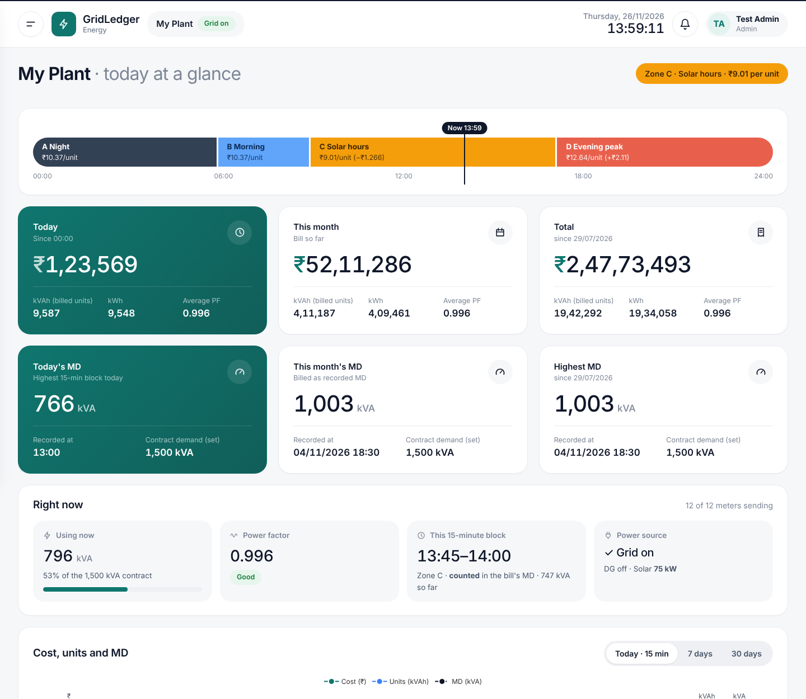
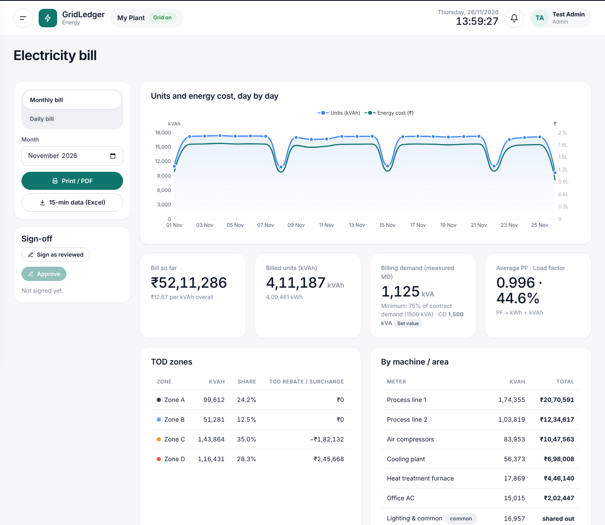
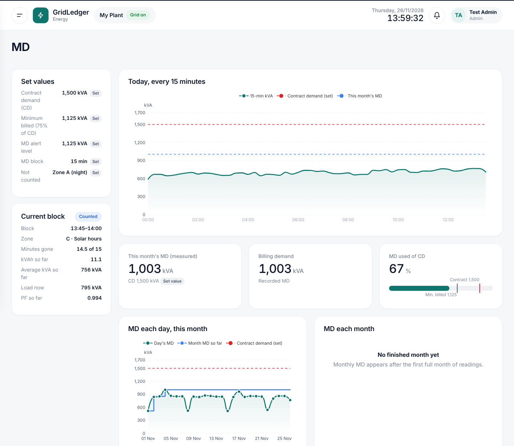
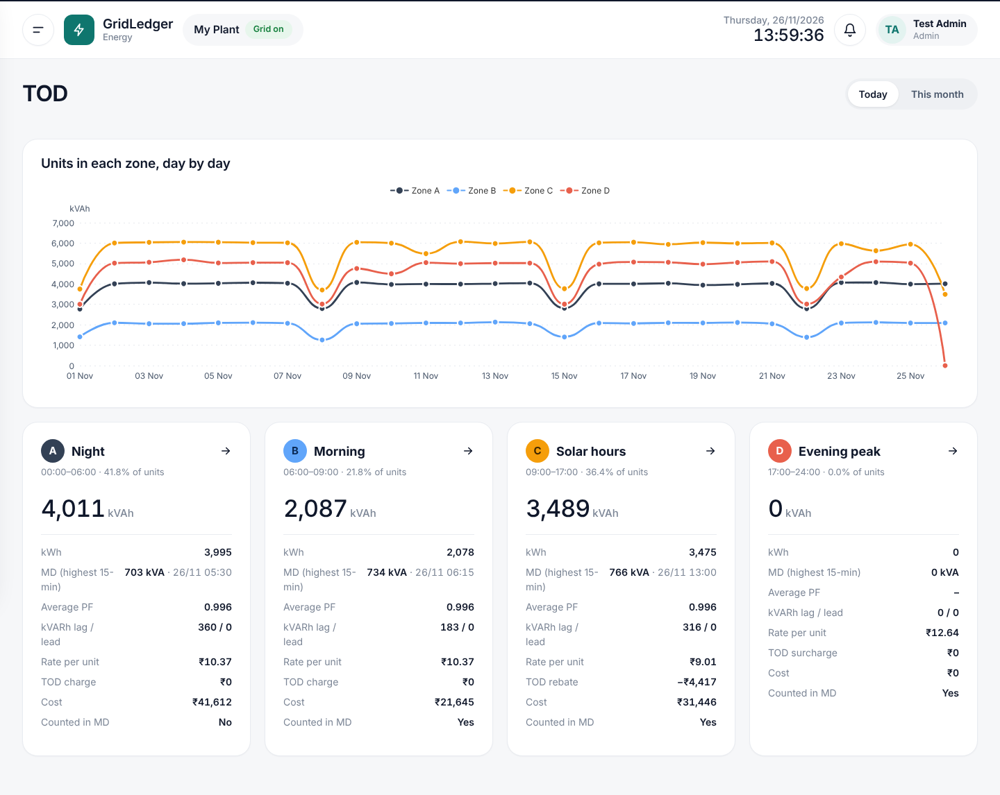
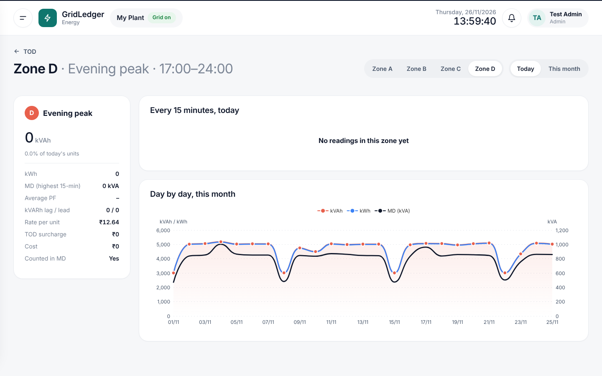
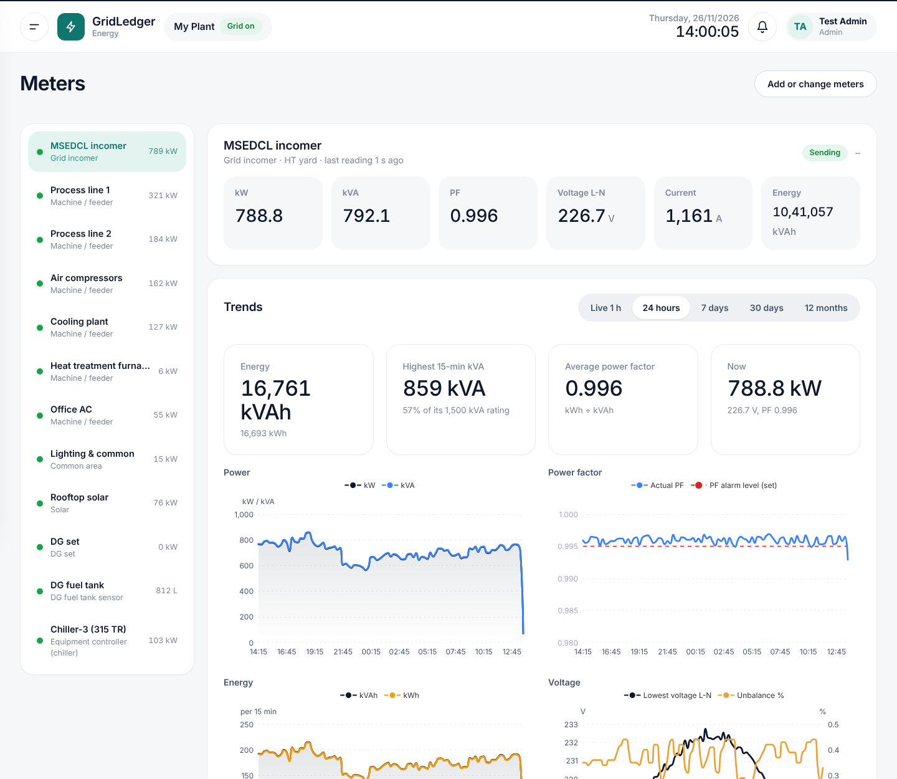
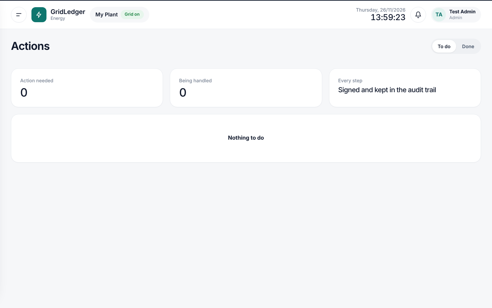
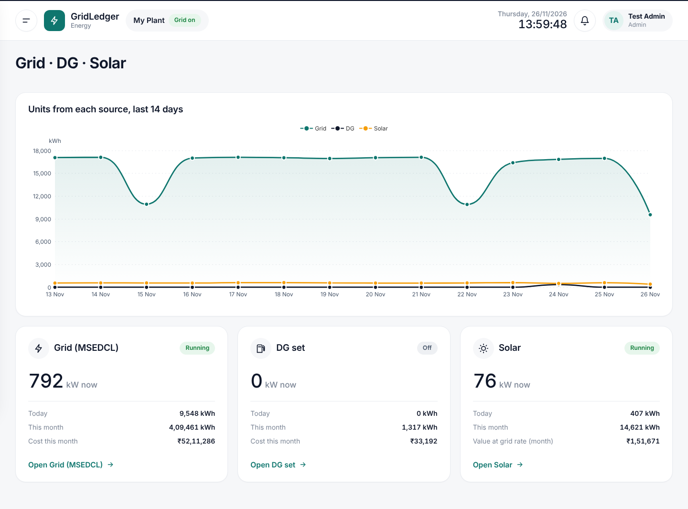
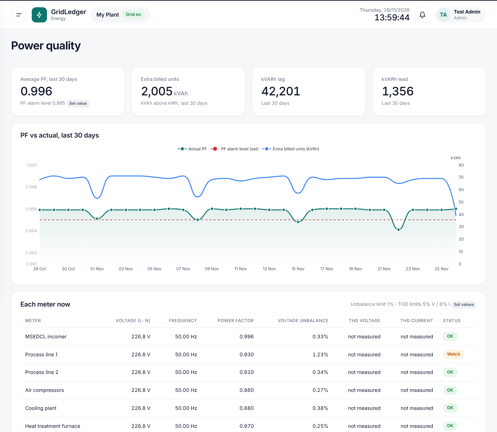
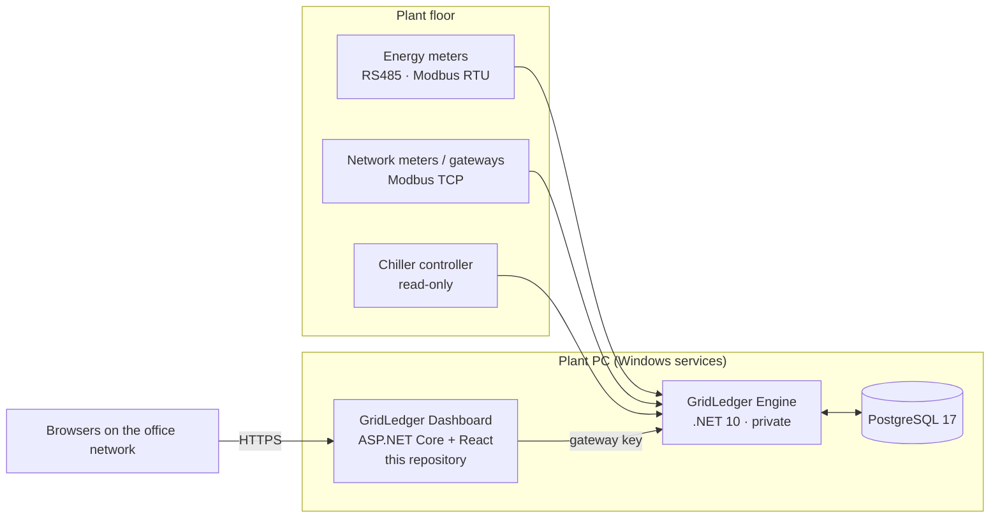

<div align="center">

# ⚡ GridLedger

**Real-time energy monitoring and electricity-cost control for industrial plants on HT (high-tension) supply**

Live meter readings · MSEDCL HT tariff shadow bill · Maximum demand · Time-of-day zones · Power quality · 21 CFR Part 11




</div>

---

## What it does

Industrial plants on an HT connection are billed on **kVAh**, **maximum demand (MD)** in 15-minute blocks, and
**time-of-day (TOD) zones** with different rates. GridLedger reads the plant's energy meters every few seconds and
shows, as it happens, what the plant is using, what it is costing and where money is being lost.

| | |
|---|---|
| **Overview** | Today / this month / total since installation in ₹, kVAh and kWh; today's, this month's and highest MD; a plain-language "right now" panel; one chart with cost, units and MD across the TOD zones |
| **Electricity bill** | Shadow bill built line by line like the utility bill: energy, demand, wheeling, TOD rebate/surcharge, FAC, electricity duty, tax on sale, PF and load-factor incentives, prompt-payment discount |
| **MD** | Contract demand and alert levels (set values) separated from measured readings; the running 15-minute block as measured; daily and monthly MD |
| **TOD** | Zone A / B / C / D cards with kVAh, kWh, MD, PF, kVARh and cost; each zone opens its own page |
| **Power quality** | Power factor, kVARh lag/lead, voltage unbalance and harmonics per meter |
| **Grid · DG · Solar** | Each source on its own page: live values, running hours, power cuts, diesel use |
| **Meters** | Meter list beside live values and trends for the selected meter; RS485 and network meters |
| **Alerts → Actions** | Compact alert list, and a signed workflow: alert → action needed → action taken |
| **Audit trail** | Every sign-in, change and signature, hash-chained and verifiable |

## Screenshots

<sub>Shown with simulated meter data. On a real plant every value starts at zero when the meters are connected.</sub>

<table>
<tr>
<td width="50%"><b>Electricity bill</b><br></td>
<td width="50%"><b>Maximum demand</b><br></td>
</tr>
<tr>
<td><b>Time-of-day zones</b><br></td>
<td><b>One zone in detail</b><br></td>
</tr>
<tr>
<td><b>Meters</b><br></td>
<td><b>Alert → action → done (signed)</b><br></td>
</tr>
<tr>
<td><b>Grid · DG · Solar</b><br></td>
<td><b>Power quality</b><br></td>
</tr>
</table>

## How it is built

GridLedger is two programs. This repository is the **Dashboard**. The **Engine** is a separate, private repository.



| Part | What it does |
|---|---|
| **Engine** (private) | Polls Modbus meters, checks every reading, builds 15-minute MD blocks, works out the tariff and bill, raises alarms, and enforces users, roles, e-signatures and the audit trail |
| **Dashboard** (this repo) | The web app people use. It holds **no plant data and no business logic**: every number comes from the Engine through a reverse proxy secured with a gateway key |

## Tech stack

- **Frontend:** React 18, TypeScript, Vite, Apache ECharts, Inter font (bundled, works offline)
- **Dashboard host:** ASP.NET Core on .NET 10, YARP reverse proxy, runs as a Windows service
- **Engine:** .NET 10, NModbus (RTU and TCP), PostgreSQL 17 with Dapper, Argon2id password hashing
- **Deployment:** PowerShell setup scripts; HTTPS for office PCs; services restart themselves and wait for the database after a reboot

## Security and 21 CFR Part 11

- Personal accounts with roles; strong passwords with expiry and history; lock-out after repeated failures; idle sign-out
- Every change needs a reason and an electronic signature (password re-entry), shown with printed name, date, time and meaning
- Audit trail with SHA-256 hash chain and daily data seals; **Check integrity** proves nothing was altered
- Database-level protection: audit records, signatures and older readings cannot be edited or deleted
- Read-only to plant equipment: GridLedger never writes to meters or controllers

## Run it

Needs Windows 10/11 (64-bit), PostgreSQL 17 and the .NET 10 runtime, and the GridLedger Engine.

```powershell
powershell -ExecutionPolicy Bypass -File .\deploy\setup-dashboard.ps1
```

Opens on `http://127.0.0.1:8080`. To open it from other office PCs over HTTPS: `deploy\enable-lan.ps1`.

### Develop

```powershell
cd web
npm ci
npm run dev        # live reload; /api is passed to the Dashboard host
npm run build      # writes the app into src/GridLedger.Dashboard/wwwroot
cd ..
dotnet run --project src/GridLedger.Dashboard
```

## Repository layout

```
web/                     React + TypeScript app (pages, charts, design)
src/GridLedger.Dashboard ASP.NET Core host: serves the app, secure gateway to the Engine
deploy/                  setup, LAN (HTTPS) and uninstall scripts
installer/               MSI build for plant sites
docs/                    screenshots
```

## About this project

- An **independent portfolio project**, written and owned by the author. It is not affiliated with, endorsed by or
  representing any company, plant or utility.
- **No customer data.** Screenshots use simulated meter data. The repository holds no bills, plant details,
  names, addresses or network settings of any real site.
- **Names of others.** MSEDCL, Schneider Electric, Microsoft, PostgreSQL and other names are trademarks of
  their owners and are used only to describe compatibility.
- **21 CFR Part 11.** The software includes controls designed to support Part 11. It is not certified by the FDA
  or anyone else; any site using it must validate it for its own use.
- **Not for safety or billing decisions** without verification against the utility's meter and bill.

## Licence

© 2026 xeevees-lab. All rights reserved. The code is shown for viewing only: see [LICENSE](LICENSE).
Open-source components keep their own licences: see [THIRD-PARTY-NOTICES.md](THIRD-PARTY-NOTICES.md).

---

<div align="center"><sub>Built by <a href="https://github.com/xeevees-lab">xeevees-lab</a></sub></div>
